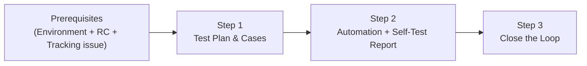

# OpenAN Test Guide — Getting Started

> Version: v0.1
> Maintained by: OpenAN Integration Testing Working Group
> Based on: [OpenAN Integration Testing Process and Framework](OpenAN%20Integration%20Testing%20Process%20and%20Framework.md) and [OpenAN Test Checklist](openan-test-checklist.md)
> Audience: Feature WG test owners, contributors, and anyone starting test work for a release
> Language: English

---

## Overview

This guide tells you **how to start your test work, step by step, once a release test cycle kicks off**.

- **This guide** = the way in: what to do, what to produce, and when each step is done.
- **[Framework](OpenAN%20Integration%20Testing%20Process%20and%20Framework.md)** = the authoritative rules (case standards, quality gates, defect management).
- **[Checklist](openan-test-checklist.md)** = the acceptance gates (TRR, release); your work is checked against it.

Every feature under test is tracked by a **feature test tracking issue**: created once in the prerequisites, updated at every step, and closed when the loop completes.

---

## Prerequisites

Before starting, confirm the following (keep it simple — each item is a checkpoint, not a task):

1. **Test environment** — provided by the [LF Networking Foundation](https://labs.lfnetworking.org/booking/detail/2058/#).
2. **RC version published** — Release Management has built and published the RC (tag, changelog, images in the registry) per the release plan. This is the entry signal for full testing.
3. **Contribution basics** — CLA signed and repository forked.
4. **Tracking issue created** — one [Feature Test Tracking](../.github/ISSUE_TEMPLATE/feature-test-tracking.md) issue per feature, linking the requirement issue(s); it is the single hub updated at every step and closed when the loop completes.

---

## Step 1 — Submit Test Plan and Test Cases

**What to do**: Turn the feature requirements into a reviewable test plan and a structured case table.

**Deliverables**:

- Test plan: `docs/plans/<version>/<feature>-test-plan.md` (from [`test-plan-template.md`](templates/test-plan-template.md))
- Case table: `docs/plans/<version>/<feature>-testcases.csv` (from [`testcases-template.csv`](templates/testcases-template.csv); field definitions in [`testcases-template-fields.md`](templates/testcases-template-fields.md))

**How**:

1. Write the test plan per the template: FIT scope, key scenarios, environment/data needs, and schedule.
2. Write one row per test case: case ID (`[FIT-<feature>-<topic>-<number>]`), priority (P0/P1/P2), preconditions, steps, expected results, and requirement link.
3. Cases must comply with Framework §6: naming and label conventions, explicit assertions, and **100% of P0/P1 cases automatable**.
4. Open a PR to `docs/plans/<version>/` (use the PR template) and request review from the Integration Testing WG.

**Optional — agent skill assist**:

- `test-cases-generator`: generates the FIT/DFX case table from the requirement proposal and design docs, with a built-in self-review loop. You review, adjust, and submit the result.

**Done when**: the plan and case table pass review and are merged into `docs/plans/<version>/` .

**Track it**: tick "Test plan and case table merged" in the tracking issue, and paste the PR link into its *Related PRs* section.

---

## Step 2 — Submit Automated Cases and Self-Test Report

**What to do**: Turn the case table into runnable automation, run it against the environment, and report the results.

**Deliverables**:

- Automated cases: `e2e/<feature>/test_<topic>.py` (pytest; frontend UI cases: Playwright under `e2e-frontend/`)
- Self-test report: `docs/reports/<version>/<feature>-self-test-report.md` (from [`test-report-template.md`](./templates/test-report-template.md))

**How**:

1. Implement the cases following Framework §6: independently repeatable, explicit assertions, teardown cleanup, no `sleep`-based synchronization.
2. Add any new environment variables to `e2e/.env.template` and document them.
3. Self-test locally: `cd e2e && pytest <feature>/ -m "not slow"`. Record pass rates and failure evidence (traces, logs, screenshots) in the report.
4. Open PRs for the case code and the self-test report; review is dual (WG reviewer + Integration Testing WG).

**Optional — agent skill assist**:

- `e2e-test-code-gen`: generates executable E2E automation code from the reviewed case table.
- `e2e-test-runner`: configures and runs the E2E suite against the environment and produces the run report.

**Done when**: TRR passes (Checklist Chapter 1) — P0/P1 cases automated and 100% passing, P2 pass rate ≥ 80%, failure evidence archived.

**Track it**: tick "FIT automated cases merged" and "TRR passed" in the tracking issue, and paste the code/report PR links into *Related PRs*.

---

## Step 3 — Close the Loop (FIT → SIT → Release)

**What to do**: With TRR passed, drive the feature through the full test cycle to the release decision.

**How**:

1. **Full FIT self-test on the RC**: the WG test owner runs all cases for the feature and publishes the self-test report (Step 2 report updated with full-run data).
2. **Regression + specialized testing** (executed by the Integration Testing WG on the RC): full FIT/SIT regression, plus specialized tests per Framework §10 (performance, 7×24h stability, security, compatibility, and others).
3. **Defect closure**: every failed case opens an issue with evidence attached; P0/P1 defects are fixed or workarounded within Framework §9.1 timelines; every fix reruns the feature's FIT cases (Framework §9.2–9.3).
4. **Pre-release regression (RC-1)**: rerun all P0/P1 cases plus all SIT on the RC-1 build.
5. **Report and archive**: the final test report is merged into `docs/reports/<version>/`; quality data feeds the TSC Go/No-Go review.

**Done when**: release gates are met (Checklist Chapter 2; Framework §8.2 and §8.3) and the Go/No-Go decision is recorded.

**Track it**: tick the remaining checklist boxes, record residual risks and their acceptors in *Notes*, then **close the tracking issue**. The issue must not remain open after the release decision.

---

## References

- [OpenAN Integration Testing Process and Framework](OpenAN%20Integration%20Testing%20Process%20and%20Framework.md)
- [OpenAN Test Checklist](openan-test-checklist.md)
- Templates: [`docs/templates/`](templates/)

## Revision History

| Version | Date | Changes |
|---------|------|---------|
| v0.1 | — | Initial version |
